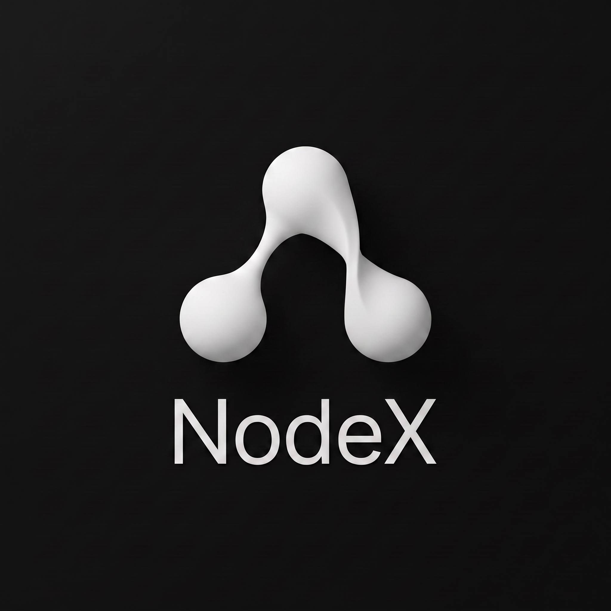
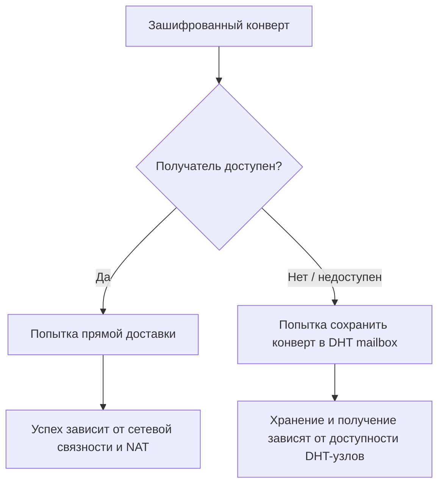

<div align="center">

  

  # ⚡ NodeX P2P Messenger

  **P2P Messenger with a Native Rust Desktop Client and Android App**

  <p align="center">
    <a href="https://github.com/NetGadz/NodeX/releases/latest/download/NodeX-Windows-x64.exe">
      
    </a>
  </p>

  <p align="center">
    <a href="https://github.com/rust-lang/rust"></a>
    <a href="https://github.com/emilk/egui"></a>
    <a href="https://en.wikipedia.org/wiki/Kademlia"></a>
    <a href="https://github.com/RustCrypto"></a>
    <a href="LICENSE"></a>
  </p>

  <p align="center">
    <b>No Phone Number Required</b> • <b>End-to-End Encryption</b> • <b>P2P Transport</b> • <b>Bootstrap-Assisted Discovery</b>
  </p>

  <p align="center">
    <a href="#-скачать-готовый-релиз-exe">📥 Скачать EXE</a> •
    <a href="#-english-overview">English</a> •
    <a href="#-описание-проекта">Русский</a> •
    <a href="#-сравнение-с-аналогами">Сравнение</a> •
    <a href="#-архитектура-системы">Архитектура</a> •
    <a href="#-быстрый-старт">Быстрый старт</a>
  </p>

</div>

---

## 📥 Скачать готовый релиз (.exe)

Для запуска NodeX на Windows **не нужно устанавливать Rust или компилировать код**! Вы можете скачать готовый исполняемый файл:

<p align="center">
  <a href="https://github.com/NetGadz/NodeX/releases/latest/download/NodeX-Windows-x64.exe" style="text-decoration: none;">
    
  </a>
</p>

> 💡 **Как запустить за 1 секунду:**
> 1. Скачайте файл [`NodeX-Windows-x64.exe`](https://github.com/NetGadz/NodeX/releases/latest/download/NodeX-Windows-x64.exe).
> 2. Запустите `.exe` двойным кликом — мессенджер сразу готов к работе!
> 3. Скопируйте вашу **Invite-ссылку** (`nodex://invite/...`) и отправьте другу.

---

## 📸 Интерфейс и Демонстрация (Previews)

| 💬 Чат и Голосовые Waveform | 🖼 Стеганография (Stego-Carriers) |
| :---: | :---: |
|  |  |
| *Компактные бабблы сообщений, нативный замер аудио-волны и аудиозвонки* | *Кодирование крипто-паспорта ноды в младшие биты пикселей PNG/JPG* |

---

## 🇷🇺 Описание проекта

**NodeX** — экспериментальный P2P-мессенджер с настольным клиентом на **Rust** и Android-клиентом на **Kotlin / Jetpack Compose**. Узлы используют настроенные bootstrap-адреса и Kademlia DHT; сообщения для недоступного получателя могут сохраняться в DHT.

Приложение не требует регистрации по телефону или электронной почте. Это не означает отсутствия серверов или метаданных: клиент по умолчанию настроен на bootstrap-узел, а DHT-узлы видят сетевые адреса, запросы и mailbox-ключи. Сообщения шифруются между идентичностями отправителя и получателя; сетевые метаданные этим не скрываются.

### Статус возможностей

- **Реализовано в коде:** Ed25519-подписи идентичностей и сообщений, X25519, ChaCha20-Poly1305-конверты, Kademlia DHT, хранение зашифрованных конвертов в DHT, локальная база данных и стегоконтейнеры.
- **Криптография сообщений экспериментальная:** Desktop отправляет конверты v4 с ephemeral-to-static X25519; Android сейчас использует несовместимые формат подписи и derivation ключа v3. По текущему коду desktop и Android не могут расшифровывать сообщения друг друга. Совместимость клиентов не работает и должна быть исправлена.
- **Нет forward secrecy:** X3DH, Double Ratchet и ML-KEM не реализованы. Компрометация постоянного X25519 ключа получателя может раскрыть ранее записанные конверты. Подписи подтверждают владение криптографическим ключом, но не личность человека; проверяйте fingerprint по отдельному доверенному каналу.
- **Экспериментальный модуль:** `nodex-kademlia/src/onion.rs` умеет строить и разбирать двухслойный пакет, но обычный маршрут отправки мессенджера его не вызывает. Переключатель Onion в интерфейсе не меняет доставку.
- **Не подключено к доставке:** opt-in relay-сервис и переключатель P2P-ретрансляции. Наличие модуля не означает доступную сеть ретрансляторов.
- **Ограничения:** STUN, UPnP, hole punching и аудиозвонки зависят от реализации, NAT и конфигурации сети; не обещается работоспособность во всех сетях. Не заявляется анонимность, сокрытие IP, защита от глобального наблюдателя или отсутствие инфраструктуры.

См. [модель угроз и ограничения](docs/security.md), [примечания к протоколу](docs/protocol.md) и [threat model](docs/threat-model.md).

### Android-клиент

Исходники Android-приложения находятся в [`nodex-android/`](nodex-android/). Для локальной сборки нужен JDK 17 и Android SDK:

```powershell
cd nodex-android
.\gradlew.bat assembleDebug
```

APK появится в `app/build/outputs/apk/debug/app-debug.apk`.

---

---

## 🌟 Ключевые технологические фичи

### 🔐 1. Идентичность (мнемоника & Ed25519)
Идентичность может быть восстановлена из мнемоники; профили и конверты используют Ed25519-подписи. Проверка подписи подтверждает владение соответствующим ключом, но не делает пользовательские утверждения истинными сама по себе.

### 🧪 2. Экспериментальный Onion-пакет
В [`onion.rs`](nodex-kademlia/src/onion.rs) есть примитив для упаковки двух слоёв шифрования. Он не подключён к обычной отправке, не выбирает ретрансляторы и не скрывает IP в текущем приложении. Считать его работающей onion-маршрутизацией нельзя.

### 🖼️ 3. Стеганографические крипто-аватарки (Stego-Carriers)
Модуль встраивает подписанную карточку контакта в LSB-представление изображения и может её извлечь. Это не гарантирует сохранность данных после перекодирования изображений соцсетями и само по себе не создаёт туннель или анонимный маршрут.

### 🎙️ 4. Экспериментальные аудиозвонки
Desktop-клиент использует WebRTC ICE, SDP offer/answer, DTLS-SRTP и Opus. Сигналинг передаётся как зашифрованное E2EE сообщение через настроенный Kademlia DHT bootstrap; bootstrap не ретранслирует медиатрафик. По умолчанию используется STUN для обнаружения сетевого адреса. Для сетей с симметричным NAT/firewall настройте TURN переменными `NODEX_ICE_SERVERS`, `NODEX_TURN_USERNAME` и `NODEX_TURN_CREDENTIAL`. Без доступного TURN связь между некоторыми сетями не установится. Полный matrix-тест с реальными внешними сетями и TURN deployment ещё не выполнен; звонки остаются экспериментальными.

### 🔐 Пароль базы и восстановление ID
Desktop при первом запуске создаёт локальную базу, зашифрованную Argon2id + ChaCha20-Poly1305; при миграции старой локальной базы приложение сначала расшифровывает прежний формат и затем сохраняет её в новом. Пароль базы нужен на каждом запуске и не восстанавливает ID. BIP-39 дополнительная парольная фраза вводится отдельно при создании или восстановлении ID: при восстановлении нужно ввести ту же фразу. Пустая BIP-39 фраза сохраняет derivation для существующих NodeX аккаунтов.

---

## 🏗 Архитектура системы

```text
┌─────────────────────────────────────────────────────────────────────────┐
│                    NodeX Desktop GUI (egui / eframe)                    │
│   Cyberpunk & OLED Themes • Movable Modals • Waveforms • Stego Studio   │
└────────────────────────────────────┬────────────────────────────────────┘
                                     │ UI Events / Commands (tokio mpsc)
┌────────────────────────────────────▼────────────────────────────────────┐
│                          nodex-messenger Layer                          │
│   User Identity (Ed25519 / X25519) • Mnemonic Seed Derivation           │
│   Stego-Carrier LSB Engine • Local Encrypted Database                   │
│   Message Delivery • Audio Call Engine • Contact Trust Registry         │
└────────────────────────────────────┬────────────────────────────────────┘
                                     │ UDP Wire Packets / Kademlia RPC
┌────────────────────────────────────▼────────────────────────────────────┐
│                          nodex-kademlia Layer                           │
│   Kademlia DHT Routing • NAT Traversal Helpers • UDP Chunking            │
│   DHT Mailbox • Experimental Onion Packet Module                         │
└─────────────────────────────────────────────────────────────────────────┘
```

---

## 📬 Доставка сообщений (упрощённая схема)



---

## 🔒 Криптография и модель угроз

| Компонент | Алгоритм / Спецификация | Назначение |
| :--- | :--- | :--- |
| **Мастер-ключ** | `BIP-39 (12/24 words) + PBKDF2` | Детерминированная генерация сида идентичности |
| **Идентификация ноды** | `Ed25519 (RFC 8032)` | Подпись профиля, DHT-запросов и предупреждений ротации |
| **Desktop envelope v4** | `ephemeral X25519 + HKDF-SHA256 + ChaCha20-Poly1305` | Шифрование полезной нагрузки; без Double Ratchet и полной forward secrecy |
| **Android envelope v3** | `ephemeral + static X25519 + HKDF v2 + ChaCha20-Poly1305` | Формат подписи и derivation отличаются; Android/Desktop несовместимы |
| **Стеганография** | `LSB Matrix Encoding` | Скрытие данных внутри пикселей изображений PNG/JPG |
| **Защита от повторов** | `Replay cache` | Отбрасывает часть повторно доставленных подписанных конвертов; не является общей защитой от MitM или DoS |

Криптографическая схема самописного приложения не прошла независимый аудит. Наличие стандартных алгоритмов само по себе не доказывает корректность протокола или безопасность реализации. Не используйте NodeX для высокорисковой переписки.

---

## 🚀 Быстрый старт

### Скачать готовый EXE (Без сборки)
👉 [**Скачать NodeX-Windows-x64.exe**](https://github.com/NetGadz/NodeX/releases/latest/download/NodeX-Windows-x64.exe)

### Сборка из исходного кода
```bash
# 1. Клонировать репозиторий
git clone https://github.com/NetGadz/NodeX.git
cd NodeX

# 2. Запустить GUI-мессенджер
cargo run -p nodex-gui --release

# 3. Запустить CLI-ноду / ретранслятор
cargo run -p nodex-cli -- --port 8443

# 4. Прогнать все тесты
cargo test --workspace
```

---

## 🇬🇧 English Overview

**NodeX** is an experimental native Rust peer-to-peer messenger. It uses configured bootstrap nodes and a Kademlia DHT; it does not currently provide anonymous routing or metadata protection.

- **No phone or email registration**: Network discovery uses configured bootstrap addresses, and DHT peers can observe network metadata.
- **Experimental desktop audio**: Uses WebRTC ICE and DTLS-SRTP; connectivity depends on NAT/firewall conditions and may require TURN.
- **Experimental message encryption**: Desktop v4 and Android v3 currently use incompatible signature formats and key derivations, so cross-client decryption does not work. No X3DH, Double Ratchet, or ML-KEM is implemented.
- **Steganography module**: Embed and extract contact-card data in supported images; third-party image processing can destroy the payload.
- **Experimental onion packet code**: Not integrated into normal message delivery; no anonymity claim is made.
- **Direct Executable**: Download [**NodeX-Windows-x64.exe**](https://github.com/NetGadz/NodeX/releases/latest/download/NodeX-Windows-x64.exe) without needing Rust installed.

---

## 📄 Лицензия (License)

Проект распространяется под лицензией **MIT License**. Подробности в файле [LICENSE](LICENSE).

<div align="center">
  <sub>Experimental peer-to-peer messaging project, built with Rust and Kotlin.</sub>
</div>
